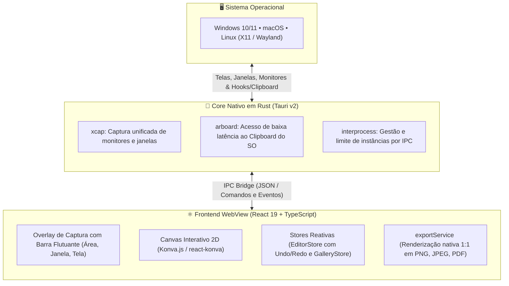

# 📸 Ferramenta de Captura Multiplataforma

[](https://tauri.app/)
[](https://www.rust-lang.org/)
[](https://react.dev/)
[](https://www.typescriptlang.org/)
[](https://vitest.dev/)
[](LICENSE)

Uma ferramenta de captura de tela nativa, ultra-rápida e minimalista para **Windows**, **macOS** e **Linux**, combinando a leveza do **Tauri v2 (Rust)** com o poder de anotação vetorial e manipulação de imagem do **React 19 + HTML5 Canvas (Konva)**.

---

## 🌟 Principais Recursos

- **Barra Flutuante de Captura (Estilo Windows Snipping Tool):**  
  Overlay escuro translúcido com seletor flutuante central para alternar entre os modos:
  - 📐 **Área:** Seleção retangular de arraste livre com dimensões em tempo real.
  - 🪟 **Janela:** Captura de janelas individuais utilizando o seletor nativo do sistema operacional.
  - 🖥️ **Tela Inteira:** Captura instantânea do monitor ativo com um clique.
  - ❌ **Cancelar:** Atalho rápido (`Esc`) para fechar o overlay sem alterar a galeria.

- **⚡ Cópia Automática Imediata (Instant Clipboard):**  
  Ao soltar o cursor após a seleção, os pixels são compactados e enviados diretamente para a área de transferência do SO. Cole instantaneamente com `Ctrl+V` (ou `Cmd+V`) no Slack, WhatsApp, Teams ou Discord sem precisar salvar arquivos.

- **🎨 Editor de Anotações Vetoriais Completo:**
  - **Formas Geométricas:** Retângulos, linhas e elipses com alça superior de rotação estilo Snipping Tool.
  - **Círculo Perfeito no Duplo Clique:** Clique duas vezes dentro de qualquer elipse para transformá-la instantaneamente em um círculo perfeito proporcional ao maior raio, com ajuste automático aos limites da imagem.
  - **Reset de Rotação:** Clique duas vezes na alça de rotação para restaurar a forma a `0°`.
  - **Flechas Vetoriais:** Suporte a traços finos (2px) com ponta aberta estilo chevron e setas curvas de 3 pontos.
  - **Lupa com e sem Foco:** Lente de ampliação direta dos pixels da imagem ou com ponto de foco e rastro fosco.
  - **Texto Inline:** Caixa de texto com fontes personalizáveis e redimensionamento dinâmico.
  - **Inserção de Imagens:** Adicione capturas secundárias ou ícones sobre o canvas.
  - **🛡️ Ocultação de Dados Confidenciais (Tarja e Blur):** Ferramenta dedicada de privacidade com duas opções de efeito visual (**Tarja Sólida** 100% opaca `#000000` e **Blur Destrutivo** de alta densidade) e dois modos ergonômicos (**Caixa Retangular Ajustável** com alças de redimensionamento e **Pincel Livre** contínuo). Na exportação e cópia, os dados originais são achatados e destruídos sem possibilidade de reversão.

- **✂️ Recorte de Imagem (Crop) com Menu Flutuante:**  
  Quadro de recorte com guias visuais e menu minimalista flutuante abaixo do ícone com botões translúcidos para confirmar (`↵ Enter`) ou cancelar (`esc`).

- **💾 Menu Horizontal de Exportação:**  
  Exportação limpa e ágil em linha para `.png`, `.jpeg` e `.pdf`, mantendo a resolução nativa 1:1 e zoom 100%.

- **🕰️ Galeria de Capturas Recentes:**  
  Histórico integrado com retenção inteligente das últimas 10 capturas e fila FIFO.

---

## 🎯 Propósito do Projeto & Laboratório de Engenharia com IA

Este projeto nasceu como um **laboratório prático de Engenharia de Software**. 

Como estudante da área, sempre me deparei com dificuldades na arte de codar. A curva de aprendizado para transformar ideias complexas em código pronto para produção muitas vezes tornava o processo lento e desmotivador.

Para mudar essa dinâmica, decidi adotar a IA não apenas como uma ferramenta de geração de código, mas como uma **tutora técnica e parceira de pair programming em tempo real**. Dessa maneira, posso criar aplicações e aprender na prática com um dev sênior me apoiando e explicando o passo a passo da entrega. A partir disso, utilizei duas ferramentas bem importantes na execução do projeto:

### Por que o uso do Superpowers com o Antigravity CLI?

1. **Spec-Driven Development (SDD):**  
   Em vez de pedir para a IA simplesmente "escrever código", o fluxo de trabalho exige a criação de uma **especificação clara e detalhada** (`docs/superpowers/specs`) e um **plano de execução em etapas** (`docs/superpowers/plans`) antes que qualquer linha de código seja criada. Isso com certeza exercitou diretamente minhas ainda não tão desenvolvidas habilidades de arquitetura, levantamento de requisitos e visão de produto.

2. **Test-Driven Development (TDD) com Rigor Técnico:**  
   Com a metodologia do Superpowers, nenhuma funcionalidade ou correção é implementada sem que antes seja criado um **teste que falha (RED)**, seguido pela **implementação mínima necessária (GREEN)** e posterior refatoração. O resultado são **143 testes automatizados** que garantem que nenhuma alteração quebre recursos anteriores.

3. **Subagentes e Separação de Responsabilidades:**  
   Através do **Antigravity CLI**, o desenvolvimento foi dividido entre agentes especializados (pesquisa, planejamento, implementação e verificação). Isso permitiu explorar na prática conceitos corporativos modernos como isolamento de contexto, revisão de código por agentes e integração contínua.

> 💡 **O Aprendizado:** O projeto me mostrou na prática que o futuro da Engenharia de Software não está preso em memorizar sintaxes, mas sim em **saber o que construir, como arquitetar, definir boas especificações, estabelecer barreiras de teste rigorosas e orquestrar ferramentas modernas para entregar um software de qualidade.**

---

## 🏛️ Arquitetura de Software

A aplicação segue uma arquitetura híbrida com separação estrita de camadas:



---

## ⌨️ Atalhos do Teclado

### Atalhos Globais de Acionamento (fora da janela)
| Sistema | Atalho Padrão | Ação |
| :--- | :--- | :--- |
| **Windows** | `PrintScreen` ou `Win + Shift + S` | Abre a barra flutuante / seleção rápida |
| **macOS** | `Cmd + Shift + 4` ou `Cmd + Shift + 5` | Captura de área retangular / barra de opções |
| **Linux** | `PrintScreen` ou `Shift + PrintScreen` | Abre a barra flutuante / captura de área |

### Atalhos na Barra Flutuante de Captura
* `1` ou `R` → Alterna para o modo **Área**
* `2` ou `W` → Alterna para o modo **Janela** (seletor nativo do SO)
* `3` ou `F` → Alterna para o modo **Tela Inteira**
* `Esc` → Cancela a captura imediatamente

### Atalhos no Editor de Imagens
* `Ctrl + C` / `Cmd + C` → Copia imagem com anotações para o Clipboard
* `Ctrl + S` / `Cmd + S` → Menu de exportação
* `Ctrl + Z` / `Ctrl + Shift + Z` → Desfazer e Refazer
* `Enter` / `Esc` → Confirmar ou Cancelar Recorte (**Crop**)
* `Duplo Clique na Elipse` → Transforma em **Círculo Perfeito**
* `Duplo Clique na Alça de Rotação` → Restaura ângulo para `0°`
* `Ctrl + +` / `Ctrl + -` / `Ctrl + 0` → Zoom In, Zoom Out e Ajustar 100%

---

## 🚀 Como Executar o Projeto

### Pré-requisitos
- [Node.js](https://nodejs.org/) (v18+)
- [Rust & Cargo](https://www.rust-lang.org/tools/install) (para compilação nativa com Tauri)

### 1. Clonar o Repositório e Instalar Dependências
```bash
git clone https://github.com/seu-usuario/ferramenta-captura.git
cd ferramenta-captura
npm install
```

### 2. Executar em Modo de Desenvolvimento (Web)
```bash
npm run dev
```

### 3. Executar como Aplicativo Desktop (Tauri + Rust)
```bash
npm run tauri dev
```

### 4. Executar os Testes Automatizados
```bash
npm test
```

### 5. Compilar o Instalador de Produção
```bash
npm run build:app
```
Os instaladores gerados (`.msi`/`.exe` no Windows, `.dmg` no Mac, `.deb`/`AppImage` no Linux) serão salvos na pasta `src-tauri/target/release/bundle/`.

---

## 📚 Base de Conhecimento

Acesse a pasta [`docs/`](./docs/README.md) para consultar os guias técnicos detalhados:

- 📖 **[Manual de Funcionamento e Fluxo de Uso](./docs/manual-de-funcionamento-e-fluxo.md)**
- ⚙️ **[Guia de Acionamento, Atalhos e Integração com o SO](./docs/acionamento-e-atalhos.md)**
- 🏛️ **[Arquitetura e Tecnologias Adotadas](./docs/arquitetura-e-tecnologias.md)**
- 🦀 **[Guia do Backend em Rust e Comandos Nativos](./docs/guia-rust-e-backend.md)**
- 🧪 **[Estratégia de Testes Unitários e Cobertura](./docs/testes-unitarios-e-cobertura.md)**

---

## 📄 Licença

Este projeto é distribuído sob a licença [MIT](LICENSE).
