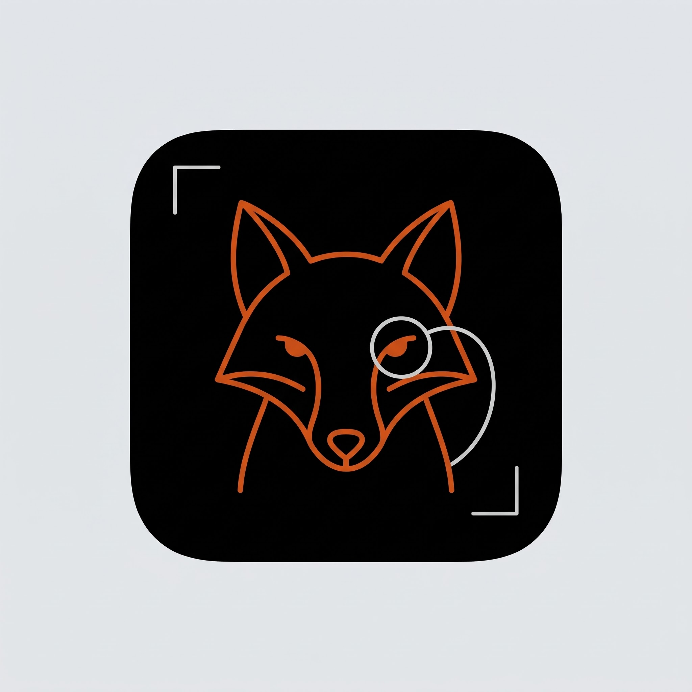
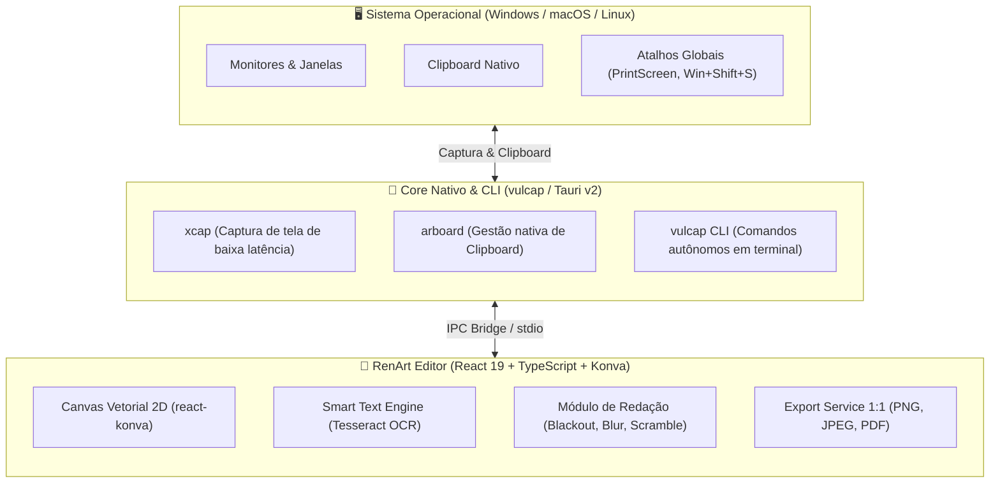

<p align="center">
  <picture>
    <source media="(prefers-color-scheme: dark)" srcset="docs/assets/renart-mascot-dark.jpg">
    <source media="(prefers-color-scheme: light)" srcset="docs/assets/renart-mascot-light.jpg">
    
  </picture>
</p>

<h1 align="center">RenArt</h1>

<p align="center">
  <strong>Captura de tela, anotação vetorial e laboratório de engenharia de software.</strong><br>
  <em>Frontend interativo em React + Konva com motor nativo desktop e utilitário CLI <code>vulcap</code> em Rust.</em>
</p>

<p align="center">
  <a href="https://react.dev/"></a>
  <a href="https://www.typescriptlang.org/"></a>
  <a href="https://vitest.dev/"></a>
  <a href="https://tauri.app/"></a>
  <a href="https://www.rust-lang.org/"></a>
  <a href="LICENSE"></a>
</p>

---

## 🦊 Origem do Nome & Escolha do Mascote

Para representar a aplicação, busquei um animal para se tornar o mascote do projeto, e a **raposa-vermelha** se encaixou perfeitamente: é um animal com facilidade de se adaptar a vários ambientes, além de ser astuta e ágil — exatamente o que a aplicação tinha como objetivo na experiência de uso.

A definição dos nomes do projeto reflete essa identidade:

- **RenArt:** *Renard* significa raposa em francês. Como a França possui um grande histórico com arte, escolhi o nome **RenArt** por remeter ao nome da raposa em francês e pela função artística do nome e da aplicação (desenhar, anotar e expressar ideias visualmente sobre a imagem).
- **`vulcap`:** O nome do núcleo nativo e CLI do projeto vem da união do nome científico da raposa (*Vulpes*) com *Cap* (de Captura).

---

## 🎯 Propósito do Projeto & Laboratório de Engenharia com IA

Este projeto nasceu como um **laboratório prático de Engenharia de Software**. 

Como estudante da área, sempre me deparei com dificuldades na arte de codar. A curva de aprendizado para transformar ideias complexas em código pronto para produção muitas vezes tornava o processo lento e desmotivador.

Para mudar essa dinâmica, decidi adotar a IA não apenas como uma ferramenta de geração de código, mas como uma **tutora técnica e parceira de pair programming em tempo real**. Dessa maneira, posso criar aplicações e aprender na prática com um dev sênior me apoiando e explicando o passo a passo da entrega. A partir disso, utilizei duas ferramentas fundamentais na execução do projeto:

### Por que o uso do Superpowers com o Antigravity CLI?

1. **Spec-Driven Development (SDD):**  
   Em vez de pedir para a IA simplesmente "escrever código", o fluxo de trabalho exige a criação de uma **especificação clara e detalhada** (`docs/superpowers/specs`) e um **plano de execução em etapas** (`docs/superpowers/plans`) antes que qualquer linha de código seja criada. Isso com certeza exercitou diretamente minhas habilidades de arquitetura, levantamento de requisitos e visão de produto.

2. **Test-Driven Development (TDD) com Rigor Técnico:**  
   Com a metodologia do Superpowers, nenhuma funcionalidade ou correção é implementada sem que antes seja criado um **teste que falha (RED)**, seguido pela **implementação mínima necessária (GREEN)** e posterior refatoração. O resultado são **373 testes automatizados** que garantem que nenhuma alteração quebre recursos anteriores.

3. **Subagentes e Separação de Responsabilidades:**  
   Através do **Antigravity CLI**, o desenvolvimento foi dividido entre agentes especializados (pesquisa, planejamento, implementação e verificação). Isso permitiu explorar na prática conceitos corporativos modernos como isolamento de contexto, revisão de código por agentes e integração contínua.

> 💡 **O Aprendizado:** O projeto me mostrou na prática que o futuro da Engenharia de Software não está preso em memorizar sintaxes, mas sim em **saber o que construir, como arquitetar, definir boas especificações, estabelecer barreiras de teste rigorosas e orquestrar ferramentas modernas para entregar um software de qualidade.**

---

## 🛠️ O que foi construído (Funcionalidades do Editor)

### 1. 🔍 Lupa Cirúrgica com Coroa Giratória
- **Ampliação de Alta Fidelidade:** Lente flutuante de zoom 2x/3x que renderiza o detalhe original sem distorcer o contexto adjacente.
- **Coroa Física Giratória:** Controle circular analógico na borda da lupa que permite rotacionar a haste de ancoragem em 360° com o mouse, adaptando-se a qualquer layout da tela.
- **Dois Modos de Foco:** Alterne facilmente entre a lente limpa (foco direto nos pixels) e a lente com anel/rastro focal translúcido.

### 2. 🧠 Smart Text (OCR em Tempo Real & Detecção Tipográfica)
- **Reconhecimento Automático:** Identifica linhas e palavras presentes na imagem capturada via **Tesseract.js**.
- **Bounding Boxes Interativas:** Passe o cursor sobre palavras ou blocos de texto identificados para destacá-los em tempo real.
- **Ação com 1 Clique:** Copie o texto detectado diretamente para o clipboard do sistema operacional ou converta-o instantaneamente em elemento de anotação ou redação.

### 3. 🛡️ Redação em 3 Níveis (Proteção Anti-IA & Privacidade)
- **Tarja Sólida (Blackout):** Tarja opaca padrão `#000000` para censura direta e total.
- **Blur Gaussiano de Alta Densidade:** Desfoque fosco suave para ocultação visual de avatares e dados secundários.
- **Scramble Criptográfico (Anti-IA):** Embaralha os pixels internos em padrões matemáticos destrutivos, prevenindo tentativas de engenharia reversa via algoritmos de des-pixelização ou OCRs neurais.
- **Destruição Irreversível:** Na cópia ou exportação, os pixels cobertos são achatados irreversivelmente — não há metadados ou camadas ocultas sob a tarja.

### 4. ⚡ Carimbo Rápido (`Alt + Click`) e Criação Contínua
- **Carimbo Imediato (`Alt + Click`):** Segure `Alt` e clique no canvas: a forma geométrica surge centralizada com dimensões padrão ergonômicas, sem a necessidade de arrastar.
- **Criação Contínua (`Alt + Drag`):** Segure `Alt` para desenhar sucessivos elementos sem desseleção acidental de ferramentas.
- **Desseleção Natural no Vazio:** Clicar fora de uma seleção desmarca as formas ativas sem criar caixas indesejadas de texto.

### 5. ✍️ Tipografia Vetorial Inline & Estilização Completa
- **Controle Tipográfico:** Ajuste de tamanho (`fontSize`), peso (`Bold`), estilo (`Italic`) e alinhamento (`Left`, `Center`, `Right`).
- **Fundo de Auto-Contraste Dinâmico:** Fundo de leitura que garante legibilidade sobre áreas claras, escuras ou multicoloridas.
- **Edição Direta:** Clique duplo para editar qualquer bloco de texto diretamente no canvas.

### Outros Recursos do Editor:
- **Barra Flutuante de Captura (Estilo Snipping Tool):** Seleção retangular por Área, Janela individual ou Tela Inteira com atalho `Esc` para cancelamento.
- **Captura multi-monitor (app desktop):** ao capturar, o RenArt congela todos os monitores e abre uma seleção em cada tela. Em **Área** você escolhe o monitor ao começar a arrastar; em **Tela Inteira** uma câmera indica qual tela será capturada ao passar o mouse. Em **Janela** a janela sob o mouse é destacada e o clique captura a janela inteira e limpa, mesmo que outra esteja por cima. No macOS é preciso liberar a Gravação de Tela. Esta captura foi validada apenas no macOS; Windows e Linux ainda não foram testados (monitores com escala diferente de 100% podem posicionar a seleção de forma errada).
- **Captura de janela:** o destaque acompanha o mouse entre os monitores, e uma janela que ocupa duas telas é destacada nas duas.
- **Bandeja do sistema (macOS):** um ícone na barra de menus mantém o RenArt disponível em segundo plano. O clique abre o menu (Nova Captura › Área / Janela / Tela Inteira, Abrir RenArt, Sair). Fechar a janela (`Cmd+W` ou o X) só a esconde: o app e o atalho `Cmd+Shift+S` continuam ativos e a captura começa **sem a janela do editor aparecer**; ao terminar, ela volta com a imagem. O ícone do Dock reabre a janela, e só "Sair" ou `Cmd+Q` encerram o app. Validada apenas no macOS.
- **Cópia Instantânea para o Clipboard:** Ao soltar o cursor após uma seleção, os pixels são enviados diretamente para a área de transferência do SO (`Ctrl+V` imediato).
- **Recorte de Imagem (Crop):** Quadro de recorte com menu flutuante translúcido para confirmação (`Enter`) ou cancelamento (`Esc`).
- **Alternância de tema (Sistema / Claro / Escuro):** Botão na barra superior que segue o tema do sistema operacional por padrão e permite forçar o modo claro ou escuro. A escolha fica salva entre sessões e o escuro usa os tons da Ferramenta de Captura do Windows 11 com destaque ciano glacial (a raposa na noite polar). A imagem exportada nunca depende do tema.
- **Exportação Multiformato 1:1:** Exportação direta para `.png`, `.jpeg` e `.pdf` mantendo a resolução nativa da captura.
- **Galeria Recente (FIFO):** Histórico das últimas 10 capturas na sessão com retenção em memória.

---

## 🏛️ Arquitetura de Software

A aplicação segue uma arquitetura híbrida com separação estrita de camadas:



### 💻 Utilitário de Terminal: `vulcap` (CLI — Especificação Fase 3)

Além da aplicação visual, o ecossistema projeta o utilitário de terminal autônomo `vulcap` (especificação planejada para a Fase 3 do roadmap) para desenvolvedores que necessitam de automação headless e integração com pipelines:

```bash
# Capturar uma área interativa e enviar para o clipboard
vulcap capture --area --clipboard

# Capturar monitor inteiro e abrir diretamente no editor RenArt
vulcap capture --screen 1 --open-in renart

# Redigir segredos e tokens de um screenshot existente em lote
vulcap redact --input error-log.png --preset api-keys --output safe-log.png

# Executar OCR em imagem do clipboard e exportar texto em JSON
vulcap ocr --clipboard --json
```

---

## 🗺️ Roadmap de Desenvolvimento

| Fase | Escopo | Status |
| :--- | :--- | :---: |
| **Fase 1: Web Core & Canvas Engine** | Editor vetorial Konva, Lupa com coroa, Smart Text OCR, Redação 3 níveis, Alt+Click, 373 testes automatizados | ✅ Concluído |
| **Fase 2: Desktop Tauri v2 & Temas** | Atalhos globais de captura do SO ✅, bandeja do sistema ✅, captura multi-monitor de região, tela inteira e janela ✅ e suporte a Tema Claro e Escuro (Light / Dark Mode) ✅ | ✅ Concluído |
| **Fase 3: Ecossistema `vulcap` CLI** | Binário CLI independente em Rust com subcomandos para captura headless, OCR e redação em pipelines de CI/CD | 🚀 Planejado |

---

## ⌨️ Atalhos do Teclado e Gestos

| Atalho / Gesto | Contexto | Ação |
| :--- | :--- | :--- |
| `Alt + Click` | Canvas | Carimba forma padrão centralizada no cursor |
| `Alt + Drag` | Canvas | Criação rápida e contínua ignorando barreira de desseleção |
| `Clique no Vazio` | Canvas | Desseleciona todos os elementos ativos com segurança |
| `Ctrl + C` / `Cmd + C` | Editor | Copia imagem achatada com anotações e redações para o clipboard |
| `Ctrl + S` / `Cmd + S` | Editor | Abre o menu de exportação rápida (PNG, JPEG, PDF) |
| `Ctrl + Z` / `Ctrl + Shift + Z` | Editor | Desfazer e Refazer ilimitados |
| `Ctrl + +` / `Ctrl + -` / `Ctrl + 0` | Canvas | Zoom In, Zoom Out e Ajustar 100% |
| `Duplo Clique na Elipse` | Canvas | Converte a elipse em círculo perfeito proporcional |
| `Duplo Clique na Alça de Rotação`| Canvas | Restaura a rotação da forma selecionada para `0°` |
| `Arrastar Coroa da Lupa` | Lupa | Gira a haste de fixação da lente em 360° |
| `Esc` | Qualquer tela | Cancela a ação ou ferramenta em execução |

---

## 🚀 Como Executar o Projeto Localmente

### Pré-requisitos
- [Node.js](https://nodejs.org/) (versão 18 ou superior)
- [Rust & Cargo](https://www.rust-lang.org/tools/install) *(necessário apenas para compilação nativa desktop com Tauri)*

### 1. Clonar o Repositório e Instalar Dependências
```bash
git clone https://github.com/nathanventura-dev/renart.git
cd renart
npm install
```

### 2. Executar o Editor em Modo Web
```bash
npm run dev
```
O editor estará disponível instantaneamente em `http://localhost:5173`.

### 3. Executar em Modo Desktop com Tauri
```bash
npm run tauri dev
```

### 4. Executar a Suíte de Testes Automatizados (Vitest)
```bash
npm test
```
*Garantia de 100% de integridade com 373 testes unitários e de integração.*

### 5. Compilar para Produção (Web & Desktop)
```bash
# Build do frontend web
npm run build

# Build do executável desktop nativo
npm run build:app
```

---

## 📚 Documentação Técnica Aprofundada

Para explorar a fundo as decisões de engenharia, arquitetura e especificações de subsistemas, consulte a pasta [`docs/`](./docs/README.md):

- 📖 **[Manual de Funcionamento e Fluxo de Uso](./docs/manual-de-funcionamento-e-fluxo.md)**
- ⚙️ **[Guia de Acionamento, Atalhos e Integração com o SO](./docs/acionamento-e-atalhos.md)**
- 🏛️ **[Arquitetura e Tecnologias Adotadas](./docs/arquitetura-e-tecnologias.md)**
- 🦀 **[Guia do Backend em Rust e Comandos Nativos](./docs/guia-rust-e-backend.md)**
- 🧪 **[Estratégia de Testes Unitários e Cobertura](./docs/testes-unitarios-e-cobertura.md)**

---

## 📄 Licença

Este projeto é disponibilizado sob a licença [MIT](LICENSE). Você é livre para usar, modificar e distribuir conforme suas necessidades.
