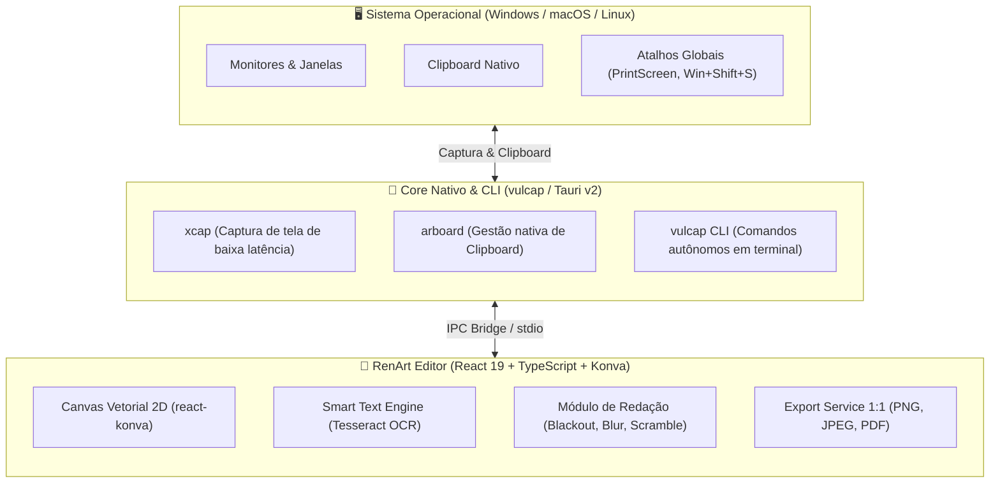

<p align="center">
  <picture>
    <source media="(prefers-color-scheme: dark)" srcset="docs/assets/renart-mascot-dark.jpg">
    <source media="(prefers-color-scheme: light)" srcset="docs/assets/renart-mascot-light.jpg">
    
  </picture>
</p>

<h1 align="center">RenArt</h1>

<p align="center">
  <strong>Precisão cirúrgica de captura, anotação fluida e redação inteligente.</strong><br>
  <em>A raposa ágil do seu fluxo de trabalho visual — com o poder nativo do utilitário <code>vulcap</code> em Rust.</em>
</p>

<p align="center">
  <a href="https://react.dev/"></a>
  <a href="https://www.typescriptlang.org/"></a>
  <a href="https://vitest.dev/"></a>
  <a href="https://tauri.app/"></a>
  <a href="https://www.rust-lang.org/"></a>
  <a href="LICENSE"></a>
</p>

---

## 🦊 Por que RenArt? (A Filosofia da Raposa)

Inspirado na raposa-vermelha (*Vulpes vulpes*) — símbolo milenar de **astúcia, velocidade e adaptabilidade** —, o **RenArt** foi concebido para eliminar o atrito entre capturar uma informação na tela e transformá-la em comunicação clara e elegante.

Enquanto ferramentas tradicionais forçam você a alternar entre editores pesados, lidar com janelas lentas ou exportar capturas sem proteção de privacidade, o **RenArt** oferece um ambiente direto ao ponto:
- **Instantâneo:** Leve como um utilitário do sistema, sem telas de carregamento morosas.
- **Preciso:** Ferramentas milimetricamente calibradas para desenvolvedores, designers, revisores e educadores.
- **Seguro:** Redação destrutiva que protege credenciais, senhas e tokens antes de qualquer compartilhamento.

O ecossistema é formado pelo frontend gráfico **RenArt** (React 19 + Konva + TypeScript) e orquestrado com o core nativo desktop e utilitário CLI **`vulcap`** (Rust + Tauri v2).

---

## ✨ Os 5 Diferenciais Únicos do RenArt

### 1. 🔍 Lupa Cirúrgica com Coroa Giratória
Diga adeus a capturas pixeladas e anotações genéricas:
- **Ampliação de Alta Fidelidade:** Lente flutuante de zoom 2x/3x que renderiza o detalhe original sem distorcer o contexto adjacente.
- **Coroa Física Giratória:** Controle circular analógico na borda da lupa que permite rotacionar a haste de ancoragem em 360° com o mouse, adaptando-se perfeitamente a qualquer layout de tela.
- **Dois Modos de Foco:** Alterne com facilidade entre a lente limpa (foco direto nos pixels) e a lente com anel/rastro focal translúcido.

### 2. 🧠 Smart Text (OCR em Tempo Real & Detecção Tipográfica)
Extração de texto sem fricção alimentada pelo motor **Tesseract.js**:
- **Reconhecimento Automático:** Detecta linhas e palavras presentes na imagem capturada com um clique.
- **Bounding Boxes Interativas:** Passe o cursor sobre palavras ou blocos de texto identificados para destacá-los em tempo real.
- **Ação com 1 Clique:** Copie o texto detectado diretamente para o clipboard do sistema operacional ou converta-o instantaneamente em elemento de anotação/redação.

### 3. 🛡️ Redação em 3 Níveis (Proteção Anti-IA & Privacidade Absoluta)
Oculte informações confidenciais antes de colar no Slack, Teams, Jira ou redes sociais:
- **Tarja Sólida (Blackout):** Tarja opaca padrão `#000000` para censura direta e inquestionável.
- **Blur Gaussiano de Alta Densidade:** Desfoque fosco suave para ocultação estética de avatares e dados secundários.
- **Scramble Criptográfico (Anti-IA):** Embaralha os pixels internos em padrões matemáticos destrutivos, impedindo tentativas de engenharia reversa via algoritmos de des-pixelização ou OCRs neurais.
- **Destruição Irreversível:** No momento da cópia ou exportação, os pixels cobertos são achatados irreversivelmente — não há metadados ou camadas ocultas sob a tarja.

### 4. ⚡ Carimbo Rápido (`Alt + Click`) e Criação Contínua
Velocidade máxima de operação sem frustração:
- **Carimbo Imediato (`Alt + Click`):** Quer adicionar um retângulo de destaque, seta ou elipse padronizada? Segure `Alt` e clique: a forma surge instantaneamente centralizada e com tamanho padrão ergonômico, sem a necessidade de arrastar.
- **Criação Contínua (`Alt + Drag`):** Segure `Alt` para desenhar sucessivos elementos sem que o canvas tente desmarcar suas seleções ou alternar ferramentas.
- **Desseleção Natural no Vazio:** Clicar fora de uma seleção desmarca as formas ativas sem criar caixas acidentais de texto.

### 5. ✍️ Tipografia Vetorial Inline & Estilização Completa
Comunicação clara com texto nativo:
- **Controle Tipográfico Total:** Ajuste fino de tamanho (`fontSize`), peso (`Bold`), estilo (`Italic`) e alinhamento (`Left`, `Center`, `Right`).
- **Fundo de Auto-Contraste Dinâmico:** Fundo de leitura que garante legibilidade absoluta sobre fundos claros, escuros ou multicoloridos.
- **Edição em Tempo Real:** Clique duas vezes para editar qualquer texto diretamente no canvas.

---

## 🏛️ Arquitetura do Ecossistema: RenArt + `vulcap`

O ecossistema é projetado com separação rigorosa de responsabilidades entre interface rica e capacidades nativas do sistema operacional:



### 💻 Utilitário de Terminal: `vulcap` (CLI)

Além da aplicação visual, o núcleo em Rust disponibiliza o comando `vulcap` para desenvolvedores que preferem automação e linha de comando:

```bash
# Capturar uma área interativa e enviar para o clipboard
vulcap capture --area --clipboard

# Capturar monitor inteiro e abrir diretamente no editor RenArt
vulcap capture --screen 1 --open-in renart

# Redigir segredos e tokens de um screenshot existente em lote
vulcap redact --input error-log.png --preset api-keys --output safe-log.png

# Executar OCR em imagem do clipboard e exportar texto em JSON
vulcap ocr --clipboard --json
```

---

## 🗺️ Roadmap de Desenvolvimento

| Fase | Escopo | Status |
| :--- | :--- | :---: |
| **Fase 1: Web Core & Canvas Engine** | Editor vetorial Konva, Lupa com coroa, Smart Text OCR, Redação 3 níveis, Alt+Click, 279 testes automatizados | ✅ Concluído |
| **Fase 2: Desktop Tauri v2** | Atalhos globais de captura do SO, bandeja do sistema (Tray), janelas multi-monitores sem bordas | 🔄 Em andamento |
| **Fase 3: Ecossistema `vulcap` CLI** | Binário CLI independente em Rust com subcomandos para captura headless, OCR e redação em pipelines de CI/CD | 🚀 Planejado |

---

## ⌨️ Tabela de Atalhos de Teclado e Gestos

| Atalho / Gesto | Contexto | Ação |
| :--- | :--- | :--- |
| `Alt + Click` | Canvas | Carimba forma padrão centralizada no cursor |
| `Alt + Drag` | Canvas | Criação rápida e contínua ignorando barreira de desseleção |
| `Clique no Vazio` | Canvas | Desseleciona todos os elementos ativos com segurança |
| `Ctrl + C` / `Cmd + C` | Editor | Copia imagem achatada com anotações e redações para o clipboard |
| `Ctrl + S` / `Cmd + S` | Editor | Abre o menu de exportação rápida (PNG, JPEG, PDF) |
| `Ctrl + Z` / `Ctrl + Shift + Z` | Editor | Desfazer e Refazer ilimitados |
| `Ctrl + +` / `Ctrl + -` / `Ctrl + 0` | Canvas | Zoom In, Zoom Out e Ajustar 100% |
| `Duplo Clique na Elipse` | Canvas | Converte a elipse em círculo perfeito proporcional |
| `Duplo Clique na Alça de Rotação`| Canvas | Restaura a rotação da forma selecionada para `0°` |
| `Arrastar Coroa da Lupa` | Lupa | Gira a haste de fixação da lente em 360° |
| `Esc` | Qualquer tela | Cancela a ação ou ferramenta em execução |

---

## 🚀 Como Executar o Projeto Localmente

### Pré-requisitos
- [Node.js](https://nodejs.org/) (versão 18 ou superior)
- [Rust & Cargo](https://www.rust-lang.org/tools/install) *(necessário apenas para compilação nativa desktop com Tauri)*

### 1. Clonar o Repositório e Instalar Dependências
```bash
git clone https://github.com/seu-usuario/renart.git
cd renart
npm install
```

### 2. Executar o Editor em Modo Web
```bash
npm run dev
```
O editor estará disponível instantaneamente em `http://localhost:5173`.

### 3. Executar em Modo Desktop com Tauri
```bash
npm run tauri dev
```

### 4. Executar a Suíte de Testes Automatizados (Vitest)
```bash
npm test
```
*Garantia de 100% de integridade com mais de 279 testes unitários e de integração.*

### 5. Compilar para Produção (Web & Desktop)
```bash
# Build do frontend web
npm run build

# Build do executável desktop nativo
npm run build:app
```

---

## 🤝 Contribuição

Contribuições são muito bem-vindas! Se você deseja colaborar com novas funcionalidades, melhorias no motor de OCR ou suporte a novas plataformas:
1. Faça um Fork do projeto.
2. Crie uma branch para sua funcionalidade (`git checkout -b feature/minha-melhoria`).
3. Certifique-se de que todos os testes passem (`npm test`).
4. Envie o commit (`git commit -m 'feat: minha melhoria'`).
5. Abra um Pull Request detalhado.

---

## 📄 Licença

Este projeto é disponibilizado sob a licença [MIT](LICENSE). Você é livre para usar, modificar e distribuir conforme suas necessidades.
