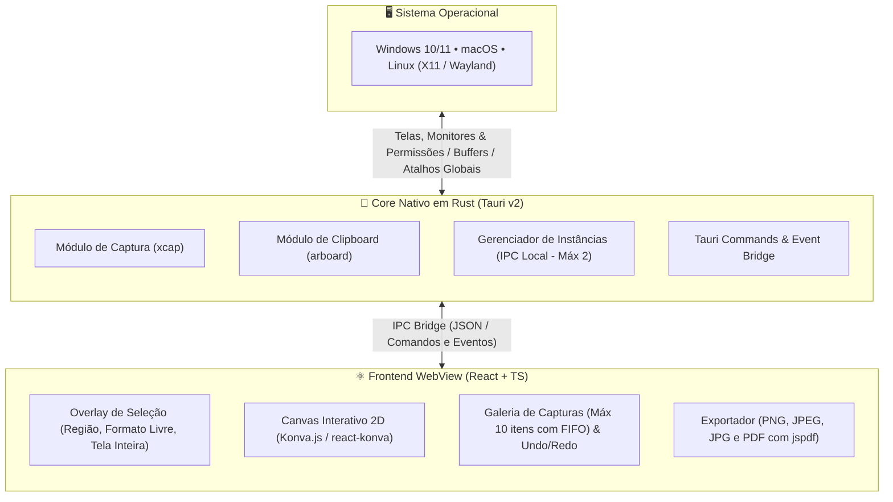

# Arquitetura e Tecnologias da Ferramenta de Captura

Este documento explica de forma clara, objetiva e detalhada toda a arquitetura de software da **Ferramenta de Captura Multiplataforma**, justificando cada tecnologia adotada e descrevendo a integração entre o Backend em Rust e o Frontend em React.

---

## 1. Visão Geral da Arquitetura

A aplicação é construída seguindo o modelo híbrido moderno viabilizado pelo **Tauri v2**:

---

## 2. Tecnologias Escolhidas e Justificativas

### 2.1. Tauri v2 (em vez de Electron)
- **Por que foi escolhido:**
  - O Electron empacota um navegador Chromium completo e uma instância inteira do Node.js para cada janela, resultando em binários de mais de 100 MB e consumo de 150 a 250 MB de RAM em repouso.
  - O Tauri v2 utiliza o motor de Webview nativo que já vem instalado no sistema operacional (WebView2 no Windows, WebKit no macOS, WebKitGTK no Linux). Isso reduz o tamanho do instalador final para cerca de **15 MB** e mantém o consumo de memória em torno de **30 a 50 MB**.
  - Para um utilitário de sistema como uma ferramenta de captura (que precisa abrir instantaneamente ao pressionar um atalho de teclado), a leveza do Tauri é imbatível.

### 2.2. Rust no Backend
- **Por que foi escolhido:**
  - **Segurança de Memória sem Garbage Collector:** Garante que a captura de telas em alta resolução (telas 4K ou múltiplos monitores) processe dezenas de megabytes de buffers de imagem brutos sem congelamentos ou travamentos causados por coletas de lixo de memória.
  - **Biblioteca `xcap`:** Biblioteca nativa de alta performance em Rust capaz de capturar janelas, monitores individuais e telas inteiras de forma unificada no Windows, macOS e Linux (suportando tanto X11 quanto sessões Wayland modernas).
  - **Biblioteca `arboard`:** Acesso direto à área de transferência do sistema operacional para copiar a imagem capturada em milissegundos.

### 2.3. React 19 + TypeScript no Frontend
- **Por que foi escolhido:**
  - Facilidade para estruturar componentes modulares e reutilizáveis (Toolbar, GallerySidebar, CaptureOverlay, CanvasEditor).
  - O TypeScript oferece checagem estática rigorosa de tipos, prevenindo erros de coordenadas nulas, estruturas de anotação inválidas e formatos não suportados antes mesmo de compilar.

### 2.4. Konva.js e `react-konva` (Motor Gráfico de Canvas 2D)
- **Por que foi escolhido:**
  - O elemento HTML `<canvas>` nativo trabalha apenas em modo imediato (pixels desenhados não podem ser clicados ou movidos depois).
  - O Konva.js implementa uma **Árvore de Objetos (Scene Graph)** sobre o Canvas. Cada retângulo, elipse, seta, texto ou lente de lupa é um nó independente.
  - Oferece suporte pronto para o componente `Transformer`, que desenha âncoras nos cantos de qualquer forma para redimensionamento e rotação com física fluida e suporte a aceleração por hardware.

### 2.5. `jspdf` para Geração de PDF
- **Por que foi escolhido:**
  - Permite gerar documentos PDF vetoriais diretamente a partir do Canvas em milissegundos, calculando o tamanho exato da folha de acordo com o aspect ratio da captura, sem precisar embutir ferramentas pesadas de conversão no backend.

### 2.6. Módulo de Privacidade e Ocultação Segura (Tarja e Blur)
- **Por que foi implementado:**
  - Fornece duas opções de efeito visual (**Tarja Sólida** 100% opaca `#000000` e **Blur Destrutivo** de alta densidade) e dois modos ergonômicos (**Caixa Retangular** e **Pincel Livre**).
  - Garante a irreversibilidade de dados sensíveis através do achatamento unificado (*flatten/bake*) na exportação (PNG, JPEG, PDF) e na cópia para o clipboard, prevenindo ataques de desofuscação por IA ou recuperação em visualizadores de PDF.

---

## 3. Fluxo de Comunicação Frontend ↔ Backend (IPC)

A comunicação entre a interface visual e o código nativo ocorre por **Tauri Commands**:

1. **Disparo da Captura:**
   - O usuário pressiona o atalho global `Ctrl+Shift+S` / `Cmd+Shift+S` ou clica em "Nova Captura".
   - O backend oculta a janela da aplicação, captura os monitores usando `xcap` e retorna os dados brutos ou abre a sobreposição transparente (`CaptureOverlay`).
2. **Cópia Imediata para o Clipboard:**
   - Assim que a seleção da região é confirmada, o backend converte os pixels recortados para PNG e utiliza o `arboard` para gravá-los na área de transferência do SO.
3. **Edição e Galeria:**
   - A imagem em formato Base64 ou dataURL é entregue ao React.
   - O estado global insere a captura na lista da galeria (garantindo o teto de 10 itens).
   - O usuário pode adicionar anotações sobre o Canvas Konva e exportar nos formatos PNG, JPEG ou PDF.
